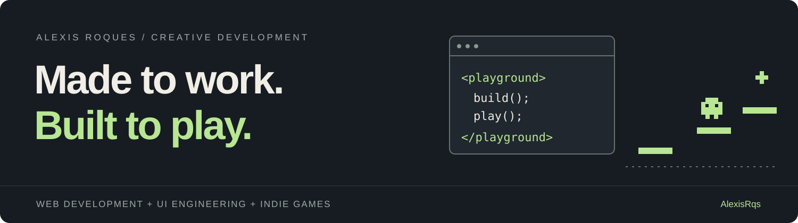

  

# Alexis Roques

### Web development · UI engineering · Indie games

I build interfaces, interactive experiences and games —  
from the first prototype to the tools that keep them running.

**[Website](https://alexisrqs.com) · [BIP BOOP](https://bipboop.io) · [Play RETRO HORDE](https://bipboop.io/play/retro-horde/)**

---

## From interfaces to playable worlds

I'm a developer based in Nice, France. My work sits between frontend development, creative coding and game development. I enjoy the details that make an interface feel right, a game feel good, and a project easier to maintain.

<table>
<tr>
<td width="50%" valign="top">

### ◇ POLARIZED
**Interactive experiences & production tools**

I build browser games, promotional campaigns and interactive Advent calendars. For the 2026 calendars, I’ve been working on the full journey from opening a door on a phone to reading that day’s offer and coupon.

**POLARIZED Games** brings together reusable mechanics, configurable templates and standalone builds. **POLARIZED Toolkit** supports campaigns in WordPress, from participation flows to analytics.

[Explore POLARIZED on GitHub →](https://github.com/POLARIZEDdev)

</td>
<td width="50%" valign="top">

### ✦ BIP BOOP
**Independent games & creative experiments**

My independent game studio, where I work on original games, distinctive visuals and satisfying gameplay.

It's a space to explore ideas through code, art and play — and turn them into something you can try.

[Play RETRO HORDE →](https://bipboop.io/play/retro-horde/)  
[Explore BIP BOOP →](https://bipboop.io)

</td>
</tr>
</table>

## On my workbench

My current project is the European Xbox edition of *Spyro: A Hero’s Tail*. I’m profiling the menu frame by frame on PS Vita.

| PS Vita port | Latest documented test on a physical Vita |
| :--- | :--- |
| [Slay the Spire](https://github.com/AlexisRqs/spire-vita) | Ports the Android version to PS Vita using an ARMv7 loader. A development build measured 38.7–39.9 FPS in a five-card Guardian scene on hardware. The build reconstructed from the public sources awaits a hardware test. |
| [Spyro: A Hero’s Tail](https://github.com/AlexisRqs/spyro-aht-vita) | Reached the title screen, main menu and save-slot screen. Three development builds averaged 1.19–1.41 FPS over frames 30–45 of the menu. |
| [Pokémon Mystery Dungeon: Red Rescue Team](https://github.com/AlexisRqs/pmd-vita) | Earlier builds ran on the handheld. The v0.47 rebuild, which adds French mission reward dialogue, awaits a hardware test. |
| [The Legend of Zelda: The Minish Cap](https://github.com/AlexisRqs/minishcap-vita) | In v0.05, settings opened from LiveArea and audio resumed after waking the Vita. The v0.06 rebuild awaits a hardware test. |

These are unofficial, AI-assisted projects shared as source for review. Each repository documents the files needed from the original game.

## How I work

- **Design to implementation.** Responsive interfaces, reusable components and design systems, from Figma to code.
- **Build once, adapt often.** Shared mechanics and configurable tools that make the next project easier.
- **Follow through to delivery.** Deployment, performance, analytics and checks against real user journeys.

<strong>Tools & technologies</strong>

 

| Area | Tools |
| :--- | :--- |
| Interfaces | React · Next.js · Tailwind CSS · shadcn/ui · Figma |
| Web & backend | WordPress · Elementor · PHP · Node.js · Python · Supabase |
| Games & visuals | Godot · Unity · PixiJS · C# · Aseprite |
| Infrastructure | AWS · CloudFront · Cloudflare · Vercel · Plesk |
| Delivery & analytics | Git · GitHub Actions · Matomo |

---

**Have a look around. Play something. Explore the code.**

[alexisrqs.com](https://alexisrqs.com) · [bipboop.io](https://bipboop.io)

