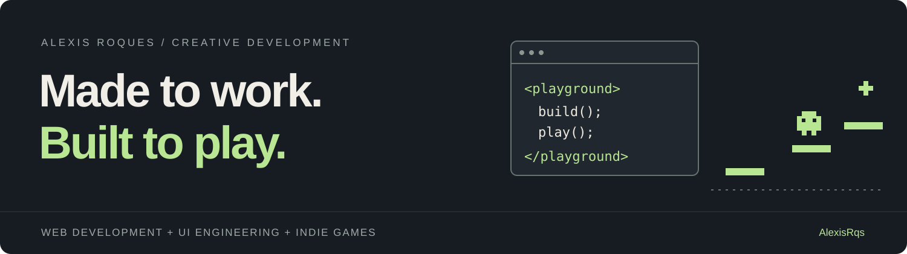

  

# Alexis Roques

### Web development · UI engineering · Indie games

I build interfaces, interactive experiences and games —  
from the first prototype to the tools that keep them running.

**[Website](https://alexisrqs.com) · [BIP BOOP](https://bipboop.io) · [Play RETRO HORDE](https://bipboop.io/en/play/retro-horde/)**

---

## From interfaces to playable worlds

I'm a developer based in Nice, France. My work sits between frontend development, creative coding and game development. I enjoy the details that make an interface feel right, a game feel good, and a project easier to maintain.

<table>
<tr>
<td width="50%" valign="top">

### ◇ POLARIZED
**Interactive experiences & production tools**

I build browser games, promotional campaigns and interactive Advent calendars.

**POLARIZED Games** brings together reusable mechanics, configurable templates and standalone builds. **POLARIZED Toolkit** supports campaigns in WordPress, from participation flows to analytics.

[Explore POLARIZED on GitHub →](https://github.com/POLARIZEDdev)

</td>
<td width="50%" valign="top">

### ✦ BIP BOOP
**Independent games & creative experiments**

My independent game studio, where I work on original games, distinctive visuals and satisfying gameplay.

It's a space to explore ideas through code, art and play — and turn them into something you can try.

[Play RETRO HORDE →](https://bipboop.io/en/play/retro-horde/)  
[Explore BIP BOOP →](https://bipboop.io)

</td>
</tr>
</table>

## On my workbench

Alongside web and indie game development, I explore **PlayStation Vita ports and platform adaptations**.

| Project | What I'm exploring |
| :--- | :--- |
| [minishcap-vita](https://github.com/AlexisRqs/minishcap-vita) | An experimental native Vita port of *The Minish Cap*, building on upstream work. |
| [pmd-vita](https://github.com/AlexisRqs/pmd-vita) | An experimental native Vita adaptation of *Pokémon Mystery Dungeon: Red Rescue Team*. |
| [spire-vita](https://github.com/AlexisRqs/spire-vita) | An experimental Android ARMv7 loader and Vita adaptation for *Slay the Spire*. |

These are unofficial, AI-assisted projects shared as source for review. Current publication candidates still need physical Vita validation; original game assets are not included.

## How I work

- **Design to implementation.** Responsive interfaces, reusable components and design systems, from Figma to code.
- **Build once, adapt often.** Shared mechanics and configurable tools that make the next project easier.
- **Follow through to delivery.** Deployment, performance, analytics and checks against real user journeys.

<strong>Tools & technologies</strong>

 

| Area | Tools |
| :--- | :--- |
| Interfaces | React · Next.js · Tailwind CSS · shadcn/ui · Figma |
| Web & backend | WordPress · Elementor · PHP · Node.js · Python · Supabase |
| Games & visuals | Godot · Unity · PixiJS · C# · Aseprite |
| Infrastructure | AWS · CloudFront · Cloudflare · Vercel · Plesk |
| Delivery & analytics | Git · GitHub Actions · Matomo |

---

**Have a look around. Play something. Explore the code.**

[alexisrqs.com](https://alexisrqs.com) · [bipboop.io](https://bipboop.io)

And yes, I still like trains.

