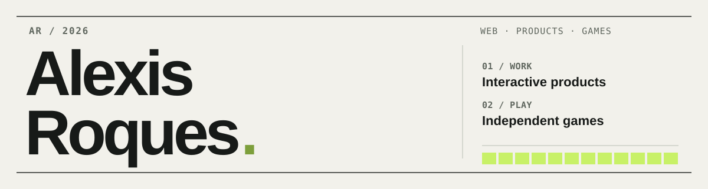

<div align="center">
  <picture>
    <source media="(prefers-color-scheme: dark)" srcset="./assets/masthead-dark.svg">
    <source media="(prefers-color-scheme: light)" srcset="./assets/masthead-light.svg">
    
  </picture>
</div>

I'm a developer working across web products, interactive experiences and indie games.

At **POLARIZED**, I build tools and systems for digital campaigns. Outside of work, **[BIP BOOP](https://bipboop.io/en/)** is where I make games, prototypes and whatever else catches my curiosity.

**[BIP BOOP ↗](https://bipboop.io/en/)** &nbsp; / &nbsp; **[Play RETRO HORDE ↗](https://bipboop.io/en/play/retro-horde/)** &nbsp; / &nbsp; **[GitHub projects ↗](https://github.com/AlexisRqs?tab=repositories)**

---

## 01 — Currently working on

**POLARIZED** — tools and interactive products

| Project | What I'm building |
| :-- | :-- |
| **Toolkit** | WordPress extensions for campaign forms, participation flows, coupon handling and integrations. |
| **Games** | Reusable game mechanics for browser-based promotional experiences. |
| **PRISM** | Internal tooling to make campaign delivery, project follow-up and analytics easier to manage. |

A lot of this work happens in private repositories. I'm especially interested in turning one-off projects into reliable systems that can be used again.

## 02 — The game side

**[BIP BOOP](https://bipboop.io/en/)** is my independent corner of the internet. No studio-sized promises; just experiments, unfinished ideas and a few things you can actually play.

| | Project | Notes |
| :-- | :-- | :-- |
| **01** | **[RETRO HORDE](https://bipboop.io/en/projects/retro-horde/)** | A small arcade survival game about staying alive, levelling up and making the next run better. **[Play the demo ↗](https://bipboop.io/en/play/retro-horde/)** |
| **02** | **[PMD Vita](https://bipboop.io/en/projects/pmd-vita/)** | An experimental native PlayStation Vita port of *Pokémon Mystery Dungeon: Red Rescue Team*. In development. |
| **03** | **[HAND LORD](https://bipboop.io/en/projects/hand-lord/)** | A medieval fantasy card roguelite prototype built around tactical encounters. **[Try it ↗](https://bipboop.io/en/play/hand-lord/)** |
| **04** | **[STONEVALE](https://bipboop.io/en/projects/stonevale/)** | A voxel RPG experiment about exploration, environments and world-building. In development. |

<sub>PMD Vita is an unofficial fan project and is not affiliated with Nintendo, Pokémon or PlayStation.</sub>

## 03 — Tools I reach for

```text
Frontend     React · Next.js · TypeScript · Tailwind CSS · Figma
Web          WordPress · Elementor · PHP · Node.js · Python
Games        Godot · Unity · PixiJS · C# · Aseprite
Infrastructure AWS · S3 · CloudFront · Cloudflare · Plesk
Analytics    Matomo · End-to-end testing · Git
```

I care about the details that aren't always visible in a screenshot: maintainability, deployment, performance, sensible defaults, and the tiny interactions that make a product feel right.

---

<sub>More experiments and project notes on **[bipboop.io](https://bipboop.io/en/)**. This README is intentionally simple; the projects do the talking.</sub>
