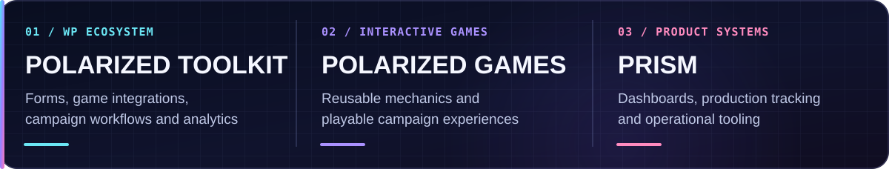
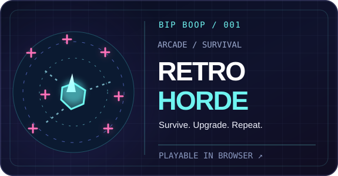
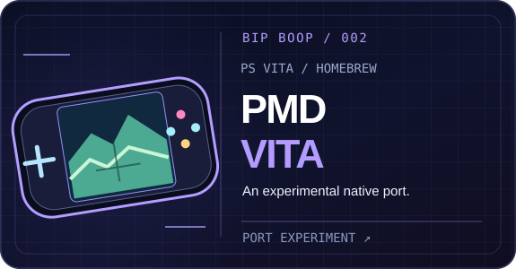
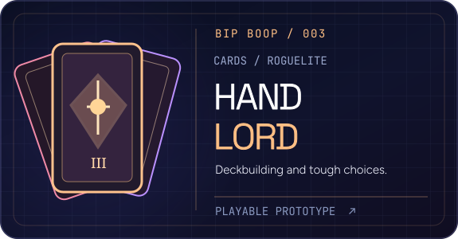
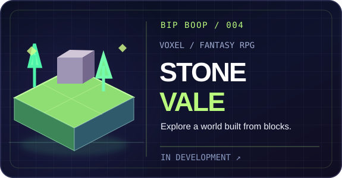
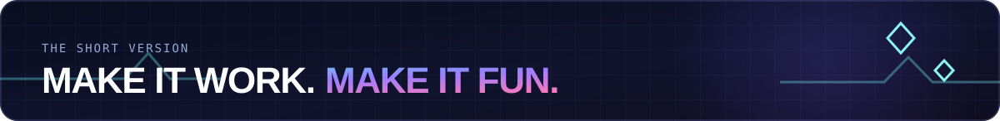

 

&nbsp;

&nbsp;

  

**Software engineering** &nbsp;✦&nbsp; **Creative development** &nbsp;✦&nbsp; **Independent games**

From polished interfaces to browser games and the systems that power them.

---

### `01` / THE WORKBENCH

**By day, I build tools and interactive experiences at POLARIZED.** I love the point where product engineering meets playful, useful interfaces: building something people can use, then making it repeatable, maintainable and reliable.

Campaign engineering · game mechanics · operational dashboards · WordPress ecosystems · cloud delivery. Most of my POLARIZED work is in private repositories.

 

### `02` / THE INDIE GAME LAB

**BIP BOOP** is my independent workshop for original games, playful experiments and unusual technical challenges. These are living projects, not polished corporate case studies.

<table>
  <tr>
    <td width="50%" valign="top">
      
      
<strong>Arcade survival meets escalating chaos.</strong> Survive enemy waves, gather upgrades and chase a better run.

      
<a href="https://bipboop.io/en/play/retro-horde/"><strong>▶ PLAY THE DEMO</strong></a> · <a href="https://bipboop.io/en/projects/retro-horde/">DEV NOTES ↗</a>

    </td>
    <td width="50%" valign="top">
      
      
<strong>A familiar adventure, on different hardware.</strong> An experimental native PS Vita port of Pokémon Mystery Dungeon: Red Rescue Team.

      
<a href="https://bipboop.io/en/projects/pmd-vita/"><strong>EXPLORE THE PROJECT ↗</strong></a>

    </td>
  </tr>
  <tr>
    <td width="50%" valign="top">
      
      
<strong>Cards, relics and calculated risks.</strong> An early medieval fantasy deckbuilding roguelite, built around tactical encounters.

      
<a href="https://bipboop.io/en/play/hand-lord/"><strong>▶ PLAY THE PROTOTYPE</strong></a> · <a href="https://bipboop.io/en/projects/hand-lord/">DETAILS ↗</a>

    </td>
    <td width="50%" valign="top">
      
      
<strong>Little blocks. Bigger worlds.</strong> A fantasy voxel-RPG experiment about exploration and world-building.

      
<a href="https://bipboop.io/en/projects/stonevale/"><strong>EXPLORE THE PROJECT ↗</strong></a>

    </td>
  </tr>
</table>

PMD Vita is an unofficial, experimental fan project; it is not affiliated with Pokémon, Nintendo or PlayStation. No game files are provided here.

 

### `03` / THE TOOLBOX

**PRODUCT & INTERFACES**

**TOOLS, PLATFORMS & GAMES**

Also working with Elementor, Matomo, C#, Unity, PixiJS, Aseprite, Supabase, Cloudflare, Plesk and automated testing.

 

### `04` / HOW I THINK

| | |
| :-- | :-- |
| **Design for humans.** | Make interactions understandable, responsive and enjoyable. |
| **Build for reuse.** | Extract repeatable systems from one-off solutions. |
| **Prototype to production.** | Think beyond the demo: deployment, monitoring and maintenance matter. |
| **Keep playing.** | Experiment across interfaces, tooling, games and hardware. |

 

<a href="https://bipboop.io/en/">**BIP BOOP / GAME LAB ↗**</a> &nbsp;•&nbsp; <a href="https://github.com/AlexisRqs?tab=repositories">**GITHUB / REPOSITORIES ↗**</a> &nbsp;•&nbsp; <a href="https://bipboop.io/en/journal/">**BUILD JOURNAL ↗**</a>

Made with curiosity, a little code and a lot of iteration.

